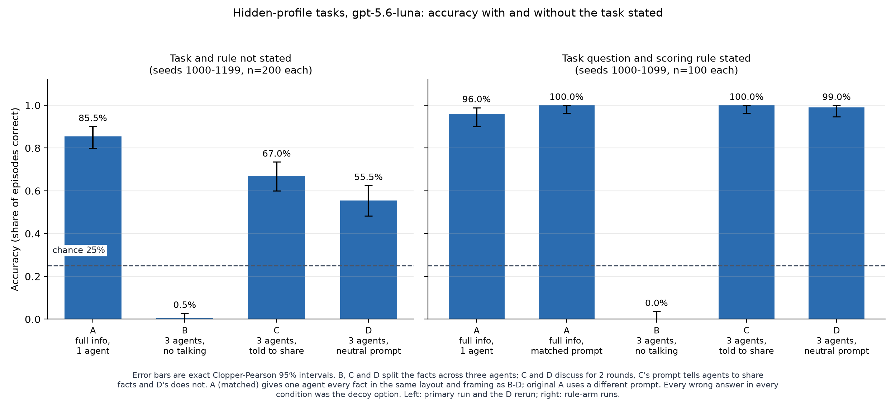

# Grapevine

Grapevine checks whether a multi-agent eval or RL environment measures
coordination or something else, and gives you environments and GRPO wiring that
pass that check.

```bash
grapevine audit hidden_profile_v2   # the bundled environment that passes
grapevine audit hidden_profile      # the one this repository's first result used
```

Offline, no API key, under a second on 200 tasks. On the environment behind this
repository's own first result, it reports three failures — a content-blind
shortcut that solves 200 of 200 tasks, an objective that never reached the
models, and a single agent able to answer alone. The committed card is
[`studies/underspecification/validity_card.md`](studies/underspecification/validity_card.md);
`hidden_profile_v2` is built to answer every one of those findings and has a
committed passing card at
[`environments/hidden_profile_v2/validity_card.md`](environments/hidden_profile_v2/validity_card.md).
How the battery works and how it is calibrated is in
[`docs/audit-battery.md`](docs/audit-battery.md).

The tool exists because that first result was wrong, and the rest of this README
is that story.

---

**Question:** when the facts needed for a decision are split across LLM agents,
what breaks?

**Finding (one model, one generated task family):** splitting the facts across
three agents who cannot talk dropped accuracy from 85.5% to 0.5%, and it stayed
at 0% even when the task was stated. Letting them talk recovered most of the
loss. The gap that remained, which I first reported as a coordination failure,
was underspecification: no prompt told the models what they were being scored
on. With the task and scoring rule stated, the communicating teams scored
100/100 and 99/100, the same as a single agent given every fact.

**The transferable lesson:** an evaluation that does not tell agents their
objective can produce a coordination failure that looks real — every fact gets
shared, the team still chooses wrong — and vanishes once the objective is
stated.



## What this is and isn't

This reproduces a known phenomenon, the hidden-profile effect (Stasser & Titus,
1985), which HiddenBench (arXiv:2505.11556) studies in LLM groups: when shared
evidence favours one option and the evidence for the right one is spread across
members, groups choose the wrong one. Grapevine makes no novelty claim for that.

What it adds is a small, fully logged case study of how an evaluation of this
effect can mislead, together with the audit that caught it.

**The underspecification finding is about my own task construction, not a
criticism of HiddenBench: HiddenBench states the objective and the payoff to its
models in the system prompt, and I did not.** Their correctness also rests on
elimination logic, mine on a counting convention I never stated, and their
headline metric is the share of individual agents choosing correctly while mine
is a single group answer. So their 30.1% and 80.7% are not directly comparable to
any number here. `docs/results.md` sets out the comparison in full.

It is one model (`gpt-5.6-luna`), one procedurally generated task template, three
agents, two discussion rounds, four options.

## Results

| Condition | Task not stated | Task and rule stated |
|---|---|---|
| A. one agent, all facts | 171/200 · 85.5% | original prompt 96/100 · 96%<br>matched prompt 100/100 · 100% |
| B. three agents, no talking | 1/200 · 0.5% | 0/100 · 0% |
| C. three agents, told to share | 134/200 · 67.0% | 100/100 · 100% |
| D. three agents, neutral prompt | 111/200 · 55.5% | 99/100 · 99% |

Chance is 25%. The task-not-stated runs used 200 tasks (seeds 1000-1199); the
rule arm used 100 (seeds 1000-1099), and every comparison between the two uses
those 100. Intervals, paired differences and the full account are in
`docs/results.md`.

- **B is the robust result.** With no communication every agent sees the decoy
  ahead in its own facts and votes for it, whether or not the task is stated.
- **The sharing instruction mattered because the task was underspecified.**
  C over D was +11.5 points [+3.0, +20.0] without the task and +1.0 [0.0, +3.0]
  with it.
- **I first read the C-versus-A gap as an integration failure.** Agents shared
  every required fact in 200 of 200 episodes and still trailed A by 18.5 points.
  Transcripts showed agents asking what decision they were supposed to make (174
  of 200 C episodes). Stating the task took C from 68/100 to 100/100 on the same
  tasks, and those requests fell to 2 of 100.
- **A second mistake, also caught:** with the task stated, C and D first appeared
  to beat A (100 and 99 against 96). A's prompt was laid out differently from the
  other conditions. Given the same layout, A scored 100/100.

## How it was checked

The docs that matter most here are the ones about my own errors:

- `docs/assumptions.md` — every assumption the result rests on, written before
  any of them were tested.
- `docs/audit.md` — what each check found, by severity, including the findings
  that made the work look worse.
- `docs/decisions.md` — every judgement call, dated, including conditions
  registered before they were run.

The experiment itself lives in
[`studies/underspecification/`](studies/underspecification/README.md). Because
the finding is about a prompt, the prompts are frozen: the exact strings sent to
the model are rebuilt from the code and hashed — 14 digests covering all 1,580
committed episodes — so a template edit that broke reproduction would fail CI
rather than pass unnoticed.

## Limitations

- The task has a trivial shortcut: counting name mentions solves 200 of 200
  full-information contexts.
- All 200 tasks share one support pattern (correct 6, decoy 5, others 1 and 0)
  and the same 12 fact sentences: one puzzle in 200 arrangements, not 200
  problems.
- The surfacing metric has precision 1.00 and recall about 0.86 against 40 hand
  labels; it undercounts paraphrased sharing.
- Temperature is stuck at 1.0 for this model, so reruns regenerate the same tasks
  but not the same answers.
- The rule arm is N=100 against N=200.
- With the task unstated, accuracy falls as the correct answer moves later in the
  option list (C: 81% at the first position, 56% at the last).
- Condition D's 4 parse failures are empty responses, probably from hidden
  reasoning tokens exhausting the output cap; not confirmed.

The full list, each with its numbers, is in `docs/results.md`.

## Reproduce

Requires Python 3.11 and [uv](https://docs.astral.sh/uv/).

```bash
git clone https://github.com/Samarth-Hiremath1/Grapevine.git
cd Grapevine
uv sync --locked --extra dev
cp .env.example .env        # put an OpenAI key in .env; it is gitignored
```

Rebuild every table and the figure from the committed runs (no API calls):

```bash
uv run python -m studies.underspecification.reproduce
```

To see the paid commands that produced the committed runs, each with the cost it
actually incurred — reconstructed from that run's own manifest, and not executed:

```bash
uv run python -m studies.underspecification.reproduce --rerun
```

Reruns regenerate identical tasks; answers vary because temperature cannot be
set for this model. A rerun writes a new timestamped directory under
`studies/underspecification/runs/` and overwrites nothing. Each run directory
holds `manifest.json` (config, seeds, git commit at start and end, metrics,
token and cost totals, failures) and one `episodes_<condition>.jsonl` per
condition with full transcripts. To compare a new run with the committed ones:

```bash
uv run python -m grapevine.experiments.compare \
    --base studies/underspecification/runs/20260910T065248Z_primary --base-cond communication \
    --other runs/<new-run> --other-cond communication_rule
```

Read a transcript, with each required fact marked by whether and when it was
shared:

```bash
uv run grapevine view studies/underspecification/runs/20260913T013826Z_rule_arm/episodes_communication_rule.jsonl
```

## Tests

```bash
uv run pytest -q
uv run ruff check grapevine tests studies
uv run mypy
```

CI runs all three on every push, plus a two-step CPU smoke test of the GRPO
training loop.

## Repository layout

```
grapevine/protocol.py   the environment protocol you implement
grapevine/audit/        the validity battery and the Validity Card
grapevine/envs/         bundled environments, the registry, protocol adapters
grapevine/rollout/      async multi-agent engine, prompt builders, provider client
grapevine/rewards/      exact-match reward, fact-surfacing metric
grapevine/experiments/  experiment runner, statistics, cross-run comparison, figures
grapevine/eval/         transcript viewer
grapevine/diagnostics/  degenerate-policy checks against the reward
grapevine/train/        TRL GRPO wiring (smoke-tested only; never trained)
studies/                one directory per case study: its configs, runs and write-up
configs/                training configs
docs/                   results, methodology, assumptions, audit, decisions
```

The library and the evidence are kept apart. `grapevine/` is the installable
package; `studies/` holds the experiments that justify what it claims, and is
not installed. The study behind this README is
[`studies/underspecification/`](studies/underspecification/README.md), which
reproduces with one command and freezes the exact prompts its runs used.

Task families plug in through `grapevine/envs/`. `hidden_profile` is the one
used here. `split_evidence` is present but **unregistered**: it leaks the gold
answer into one agent's view in 100 of 100 generated tasks, so nothing that
resolves a family by name will hand one out (`docs/decisions.md`). It is either
fixed or deleted in v0.2.

## Citation

- Li, Y., Naito, A., & Shirado, H. Systematic Failures in Collective Reasoning
  under Distributed Information in Multi-Agent LLMs. ICML 2026 (PMLR 306).
  arXiv:2505.11556v4. The 30.1% and 80.7% figures quoted in `docs/results.md`
  were checked against its abstract.
- Stasser, G., & Titus, W. (1985). Pooling of unshared information in group
  decision making. *Journal of Personality and Social Psychology*, 48(6),
  1467-1478. **UNVERIFIED**: these citation details have not been checked against
  the source.

## License

MIT, see [LICENSE](LICENSE).
