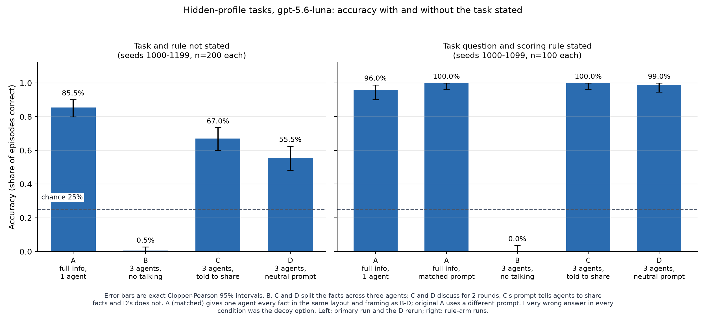

# Underspecification can look like coordination failure

**A case study in evaluating multi-agent LLM coordination, including two mistakes
I made and how an audit caught them.**

Samarth Hiremath · September 2026 · [Grapevine](https://github.com/Samarth-Hiremath1/Grapevine)

---

## Summary

I split the evidence for a decision across three LLM agents and measured what
that costs. A single agent holding every fact scored 85.5%. Three agents holding
one third each, with no channel between them, scored 0.5% — well under the 25%
chance line, because the facts they share all point at one specific wrong answer.
Letting them talk recovered most of the loss.

Then I got the remainder wrong. I reported that an 18.5-point gap survived even
though the agents shared every required fact in 200 of 200 episodes, and I read
that as a failure to integrate pooled evidence. It wasn't. My prompts never told
the models what question they were answering or how I was scoring them. I stated
the task, reran the same seeds, and the communicating conditions went to 100/100
and 99/100. The agents' repeated requests for a decision rule fell from 174 of
200 episodes to 2 of 100.

A second, smaller mistake followed. With the task stated, the distributed teams
appeared to beat the single agent holding every fact: 100 and 99 against 96. An
audit found that the single-agent prompt used a different layout from the other
conditions. I matched the layout and reran. It scored 100/100. There is no
"distributed beats centralized" result here, and I nearly published one.

The useful part is methodological. An evaluation can withhold its own objective
without its author noticing, and the resulting failure looks exactly like a
coordination failure. It also survives the obvious sanity check: I had a metric
that measured whether agents shared their facts, it read 100%, and the teams
still answered wrong. The cheap test is to state the objective and rerun. Mine
cost about 20 cents.

**This is a finding about my task construction, not a criticism of HiddenBench**,
the prior work that motivated it. HiddenBench states the objective and the payoff
to its models in the system prompt. I did not.

---

## 1. The task

Each task is a hiring decision with four candidates, generated from a seed.
A candidate's quality is just the number of facts supporting it. The support
pattern is fixed at (6, 5, 1, 0): the correct candidate has six supporting facts,
a decoy has five, and the two remaining options have one and none.

The split is what makes it hard. All five of the decoy's facts go in the shared
block that every agent sees. All six of the correct candidate's facts are
private, two per agent. So each agent, reading its own context, sees the decoy
leading 5 to 2 and has no reason to doubt it. The correct answer only wins when
all six private facts reach one place, and it wins by a single point, which means
every private fact is load-bearing. Drop one and the task flips to a tie.

Three properties get asserted in tests for every seed I use: no required private
fact leaks into the shared block, the full-information context contains all of
them, and no single agent's context favours the correct candidate on its own.
I check these because an earlier task family, `split_evidence`, failed the
first one. Its final reasoning hop named the answer outright, so one agent held
the answer string with no pooling at all. I measured it over 100 tasks, found
the leak in 100 of them, and cut the family from the experiment. `run.py` now
rejects any family except `hidden_profile` at config load, rather than leaving a
future reader to notice.

## 2. The harness

Everything runs through one async engine (`grapevine/rollout/engine.py`), which
keeps the conditions comparable: same client, same retry policy, same token cap,
same parser. The primary run made 3,600 API calls at concurrency 8, burned
1.39M prompt and 399K completion tokens, and finished in 14 minutes for $0.76.

Four pieces of it are worth describing, because three came out of bugs:

**Per-episode cost accounting.** The first version read the client's running
totals before and after each episode and subtracted. Episodes share one client,
and every `await` lets them interleave, so each episode absorbed the others'
tokens. Four concurrent episodes reported 13, 14, 15 and 16 calls when each had
made 4 — 58 against a true total of 16. Only the client-level total was right.
Now each episode accumulates the completions it actually received.

**The answer parser.** It used substring matching in both directions, which meant
an empty answer or a stray letter mapped to the first option, and free text took
the last option mentioned. On 18 adversarial outputs I wrote to break it, it
returned a *wrong option* 7 times rather than failing. It now returns an option
only when exactly one is identified, by whole-word match, and refuses otherwise.
I re-parsed all 2,120 committed answers and votes under the fixed parser: not one
reported number moved. The bug was latent, not active. I still would not have
known that without checking.

**Paired statistics.** Differences between conditions are paired on the same
tasks, and the original code zipped two lists positionally after dropping failed
episodes. One dropped episode in one condition would have silently shifted every
subsequent pair. Alignment now happens on task id, and a mismatched task set
exits with an error instead of a number.

**Run provenance.** The manifest used to record the git commit at the *end* of a
run. Edit a file during a 14-minute run and the manifest points at code that
never produced it. It now captures the commit and dirty flag before the first API
call, again at the end, and sets `tree_changed_during_run` if they differ.

Intervals for single conditions use exact Clopper-Pearson, computed by bisection
on the binomial CDF in log space, so there's no SciPy dependency. I switched to
it after noticing the bootstrap collapsed at the extremes: 1/200 came out as
[0, 1.5%] from the bootstrap, which claims more certainty than 200 samples can
support. Clopper-Pearson gives [0.02%, 2.75%]. Differences still use a paired
bootstrap.

## 3. Conditions

All four run on the same seeds, so every comparison is paired.

| | Agents | Sees | Answer from |
|---|---|---|---|
| **A** full information | 1 | every fact | that agent |
| **B** no communication | 3 | own facts only | majority vote |
| **C** instructed sharing | 3 | own facts + transcript | aggregator, 2 rounds |
| **D** neutral prompt | 3 | own facts + transcript | aggregator, 2 rounds |

C's prompt tells agents to share their facts and ask for what they lack. D's
doesn't, on any call. D exists because the obvious objection to C is that the
instruction, not the discussion, did the work — so I registered D in the decision
log before running it, rather than caveating C afterwards.

Every condition also has a **rule arm**, which prepends the task's question and
the scoring rule to every prompt and changes nothing else. The flag is off by
default, and a test checks the default prompts stay byte-identical, so the
original command still reproduces the original run.

The tie-break for B's majority vote was fixed in advance too, because with 3
agents and 4 options a three-way split is possible and the rule could move B's
headline number on its own. Ties resolve uniformly at random from a generator
seeded on the task id. It never mattered: all three votes agreed in every single
episode.

## 4. Results



| Condition | Task not stated (N=200) | Task and rule stated (N=100) |
|---|---|---|
| A, original prompt | 171/200 · 85.5% [79.8, 90.1] | 96/100 · 96.0% [90.1, 98.9] |
| A, matched prompt | not run | 100/100 · 100% [96.4, 100] |
| B | 1/200 · 0.5% [0.0, 2.8] | 0/100 · 0.0% [0.0, 3.6] |
| C | 134/200 · 67.0% [60.0, 73.5] | 100/100 · 100% [96.4, 100] |
| D | 111/200 · 55.5% [48.3, 62.5] | 99/100 · 99.0% [94.6, 100] |

Chance is 25%. The rule arm ran on the first 100 of the 200 seeds, and every
comparison across arms uses those 100.

**Distribution without communication is catastrophic, and stating the task does
nothing for it.** B scored 1/200 without the task stated and 0/100 with it. The
votes were unanimous in every episode. This is the one cell that nothing I did
moved, and it's the result I'd defend hardest.

**Communication recovers the loss.** C − B is +66.5 points [+60.0, +73.0]. D − B
is +55.0 [+48.0, +62.0].

**Stating the task closes what was left.** Paired on the same 100 tasks: C gains
32 points [+23, +41], D gains 46 [+36, +56], A gains 13 [+6, +20], B gains
nothing.

**The sharing instruction mattered mostly because the task was underspecified.**
C − D was +11.5 points [+3.0, +20.0] with the task unstated. With it stated, the
same difference is +1.0 [0.0, +3.0].

**Every wrong answer, in every condition, was the decoy.** Across 800
task-not-stated episodes, not one picked a wrong option other than the decoy.
These failures are systematic.

## 5. What I got wrong

The original headline was that full surfacing didn't close the gap. Agents shared
every required fact, the surfacing metric read 100%, and C still trailed A by
18.5 points. I read that as an integration failure: they have the facts, they
can't use them.

The transcripts said otherwise, and I'd been reading past it. Agents kept asking
what decision they were supposed to produce.

| | Episodes where an agent asked for criteria, a ranking, or the decision to produce |
|---|---|
| C, task not stated | 174 / 200 |
| C, task stated | 2 / 100 |
| D, task not stated | 136 / 200 |
| D, task stated | 1 / 100 |

Here is `hidden_profile-1006`, where all six facts supporting the correct
candidate reached the table and the team still answered with the decoy:

> **agent2:** Finley designed the on-call rotation the team still uses, rewrote a
> flaky test suite to full reliability [...] What final output do we need —
> selection, ranking, or hiring recommendation — and what criteria or weighting
> should we apply?
>
> **aggregator:** `{"answer":"Devon"}`

Same seed, task stated: `{"answer":"Finley"}`.

A second symptom pointed the same way. With the task unstated, C's accuracy fell
as the correct answer moved later in the option list — 81% in the first position,
56% in the last. State the task and that disappears: C, D and matched A sit at or
near 100% in every position. A model with no stated objective falls back on
position. A model with one doesn't.

So the pooling worked. The agents did their half. My evaluation never told them
what to do with what they'd pooled, and then I blamed them for it.

**The audit ledger came first, which is the only reason this held up.** Before
running a single check, I wrote `docs/assumptions.md`: every assumption the
result rests on, where it lives in the code, and how it could be tested. Writing
the list first keeps it from quietly shrinking to the things that turn out to be
convenient to verify. Then I tested them offline against committed code and
logged runs, at $0, and reported by severity with the worst findings first.

That pass turned up two problems that invalidated claims I'd made, eleven that
narrowed them, and the three code defects in §2.

## 6. The second mistake

With the task stated, C (100/100) and D (99/100) came out above A (96/100). That
is a tidy, quotable, "distributed teams beat the single agent" result, and it was
wrong.

A's prompt differed from B, C and D in more than information. It used a flat fact
list with no shared/private headers, a different system prompt, and a user prompt
containing the line "Full team discussion: (you have all information; no
discussion needed)". A 4-point gap is well within what that could produce on its
own.

So I registered the control before running it, wrote down both readings in
advance — near 96% means the gap is real, near 100% means it was presentation —
and ran condition A again with the same information in B–D's layout. It scored
100/100. Cost: 1.5 cents.

I also dropped "ceiling" and "upper bound" from every description of A, in the
code as well as the docs. A single agent with every fact is a baseline, not an
upper bound. Two conditions match it, and a name-counting heuristic beats it.

## 7. Limitations

Each with its number, because a clean-looking limitations section is a bad sign.

- **The task has a trivial shortcut.** Counting candidate-name mentions solves
  200 of 200 full-information contexts. This measures whether a model applies a
  counting rule, not whether it reasons over fact content.
- **200 tasks, one puzzle.** Every task uses the (6, 5, 1, 0) pattern and the
  same 12 fact sentences, varying names, assignment, filler and order. The
  intervals describe variation over arrangements, not over content.
- **The surfacing metric is a string matcher.** Against 40 model labels (`docs/audit_surfacing_labels.md`): precision
  1.00 (20/20), recall about 0.86. It never credits an unshared fact, so the 100%
  reading isn't inflated, but it undercounts paraphrase. Only C's prompt asks for
  verbatim facts and the matcher rewards verbatim wording, so part of the C-vs-D
  surfacing gap is the metric measuring itself.
- **Temperature could not be set.** `gpt-5.6-luna` rejects an explicit
  temperature, so everything ran at 1.0. Reruns regenerate identical tasks and
  different answers.
- **The rule arm changes two things at once.** It supplies the question *and* the
  scoring rule. I can't say which one mattered.
- **The scoring rule is a counting convention.** No agent could derive "most
  supporting facts wins" from the facts themselves, so stating it may make the
  task easier in a way that goes beyond fixing underspecification.
- **The aggregator isn't a typical agent.** It always holds two filler facts to
  the others' one, and sees its own facts twice. Unmeasured.
- **Condition D had 4 empty responses**, probably hidden reasoning tokens
  exhausting the 400-token cap. Probable, not confirmed: usage is logged per
  episode, not per call.
- **"Asked for criteria" is an unvalidated keyword match.**
- **The rule arm is N=100 against 200.**
- One model, one template, three agents, two rounds, four options.

## 8. Relation to prior work

HiddenBench (Li, Naito & Shirado, arXiv:2505.11556v4, ICML 2026) reports 30.1%
accuracy for multi-agent groups under distributed information against 80.7% for
single agents with complete information. I checked both figures against the
paper.

My numbers are **not** comparable to theirs, for three reasons:

1. **They state the objective; I did not.** Their discussion system prompt opens
   with the task description, which says what to decide, lists the options, and
   states that exactly one is correct.
2. **Correctness is established differently.** Their tasks resolve by
   elimination: every wrong option clashes with some fact. Mine rest on a
   counting convention.
3. **The metric differs.** Theirs is the share of individual agents choosing
   correctly after discussion. Mine is one group answer per episode.

What I do share with that literature is the qualitative finding. Splitting
information across agents hurts, and the failures concentrate on whichever option
the shared evidence favours.

The PDF isn't in this repository — its arXiv licence doesn't grant
redistribution. It's cited by version and SHA-256 instead. The Stasser & Titus
(1985) citation remains marked **UNVERIFIED** in the README, because I never got
a copy of that paper and I'm not going to pretend otherwise.

## 9. What I'd do next

1. **Separate the question from the scoring rule.** Two arms, one stating each.
   About $0.20, and it resolves the biggest open question in §7.
2. **Kill the shortcut.** Rewrite facts so they don't begin with the candidate's
   name. Name-counting then fails and the task needs actual reading.
3. **Vary the content.** The 12-sentence pool makes 200 tasks into one puzzle.
   A larger pool would let the intervals describe variation over tasks.
4. **Then scale the original question**: group size, round budget, and whether
   communication protocols help at all once the objective is unambiguous.

## Reproducing

```bash
uv sync --locked --extra dev
uv run python -m studies.underspecification.reproduce   # all tables + figure, no API calls
```

Every run directory is committed with its manifest, full transcripts, git commit
and cost. Total API spend for every number in this report: $1.53. `docs/experiment.md`
has the commands that produced each run.
